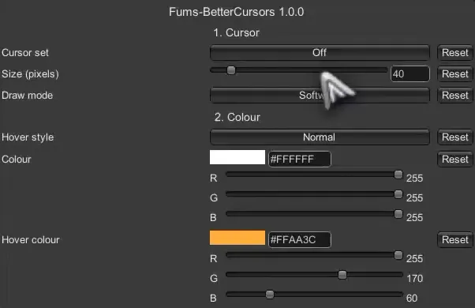

# Better Cursors

Swap the game's cursor for a sharp one, pick its size and colour.

The game's cursor is small and Windows stretches it, so a large Windows pointer makes it blurry. Better Cursors draws the cursor at the exact size you pick, so it stays sharp.

## Install
SPT 4.1.x. Client only, nothing goes on the server. Extract the zip into your SPT folder. It puts the plugin in `BepInEx\plugins\BetterCursors`.

To remove it, delete that folder.

## Settings
Press **F12** in game > Fums-BetterCursors. The cursor is left alone until you pick a set.

- **Cursor set**: Off (the default), the game's own cursors, or one of the 10 sets that come with it.
- **Size (pixels)**: how big the cursor is. The game's own is about 41.
- **Draw mode**: Software keeps it sharp at any size. Hardware follows the mouse a frame sooner but Windows may blur it.
- **Hover style**: over something you can click, Normal turns the cursor the hover colour, Hand swaps it for a pointing hand.
- **Colour** and **Hover colour**: click the colour for sliders, or type a hex code. White leaves a cursor as it's drawn.

## Your own cursors
Make a folder in `BepInEx\plugins\BetterCursors\cursors` with an `idle.png` in it and restart the game. It shows up in **Cursor set**. Big images (256 px) stay sharpest.

## Credits
The Kenney sets are made from Kenney's [Cursor Pack](https://kenney.nl/assets/cursor-pack) (CC0).

## Reporting issues
Please report issues in my Discord thread on the SPT server [here](https://discord.com/channels/875684761291599922/1562201063535415536), in this mods issue section, or on [GitHub issues](https://github.com/MrFums/BetterCursors/issues).
